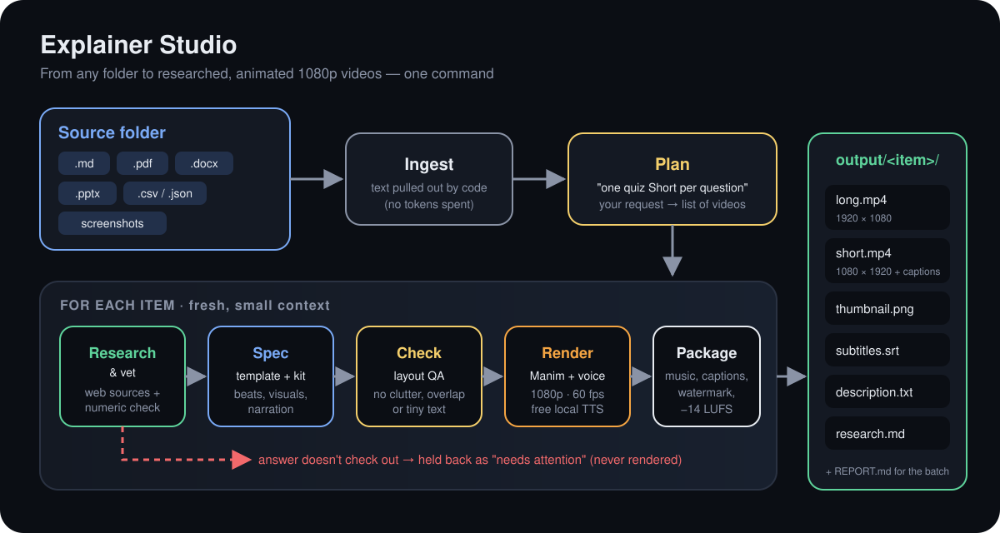
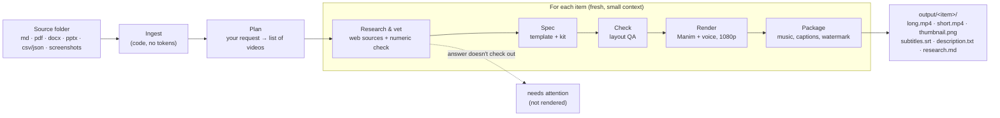
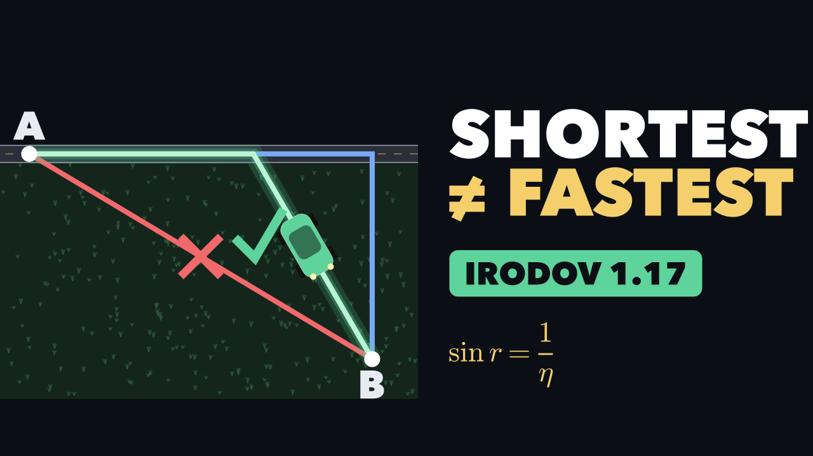

# Explainer Studio

Turn a folder of notes, questions, PDFs or screenshots into **researched, fact-checked, animated
explainer videos**: a full 1080p YouTube video, a vertical Short with captions, a thumbnail,
subtitles and a ready-to-paste description. All from one command in Claude Code.

It works for any subject (physics, maths, chemistry, biology, history, coding…). After a one-time
setup, everything renders on your own computer with a free voice: no subscriptions, no API keys.



<details>
<summary>Same flow as text (Mermaid)</summary>


</details>

## What you get, per item

| File | What it is |
|---|---|
| `long.mp4` | 1920×1080, 60 fps YouTube video with narration, music, sound effects, chapters |
| `short.mp4` | 1080×1920 vertical Short with big word-by-word captions |
| `thumbnail.png` | 1280×720 thumbnail |
| `subtitles.srt` | upload to YouTube as captions |
| `description.txt` | title, chapters, sources, hashtags, ready to paste |
| `research.md` | what was checked and where (sources with links) |



## Quick start (Windows first; Mac and Linux are the same)

You need **Claude Code** (the desktop app's *Code* tab or the terminal).

**1. Install the plugin.** In Claude Code, type:
```
/plugin marketplace add sharatvikas/explainer-studio
/plugin install explainer-studio@explainer-studio-marketplace
```
It asks for your channel name, website, optional logo, voice and defaults. You can change these later in `/config`.

**2. Set up once (about 5 minutes, ~400 MB download).** Open the folder where you want to make videos, then:
```
/explainer-studio:setup
```
If it says **uv** is missing, paste this into the chat (Windows) and restart Claude Code:
```
! powershell -ExecutionPolicy ByPass -c "irm https://astral.sh/uv/install.ps1 | iex"
```
(Mac/Linux: `! curl -LsSf https://astral.sh/uv/install.sh | sh`)

**3. Put your material in `input/`.** Anything works: a Markdown or text file of questions, a PDF chapter, Word notes, slides, a CSV of quiz questions, or screenshots.

**4. Make the videos.**
```
/explainer-studio:make
```
or tell it what you want:
```
/explainer-studio:make input "one 60-second quiz Short per question"
/explainer-studio:make notes/photosynthesis "a 4-minute explainer and 3 Shorts on the key ideas"
/explainer-studio:make input/jee "worked solution for each problem: long video, Short and thumbnail, deep research"
/explainer-studio:make history "a timeline video of the Mughal empire, about 4 minutes"
```
Finished files appear in `output/<item>/`, with a summary in `output/REPORT.md`.

## Writing questions in a file

```markdown
## Q1. Where should the car leave the road?
A car on a highway must reach point B in a field, where it moves η times slower...
**Answer:** CD = l / sqrt(η² - 1)
**Source:** Irodov 1.17

## Q2. Projectile range
At what angle is the range greatest?
**Answer:** 45 degrees
```
CSV/JSON use the columns `question, answer, solution, title, source, notes`. Answers are optional: the research step works them out and checks them.

## Research and fact-checking

Every item is checked before it becomes a video:

| Level | What happens | Use when |
|---|---|---|
| `vet` (default) | Claude solves it independently, checks 2–3 reputable sources, and verifies maths numerically | always a good idea |
| `deep` | also finds common misconceptions (used as "tempting wrong answers"), real-world hooks, and how other videos cover it, to pick a fresh angle | your best videos |
| `off` | uses your material as-is | you already trust the answers |

If the answer can't be confirmed, the item is **held back** and listed under *Needs attention* in
`REPORT.md` with the evidence. A video that teaches something wrong is never made. Research gathers
facts only: the scripts and visuals are always original.

## Quality

- Final renders are always **1080p at 60 fps** (Shorts 1080×1920). The packager refuses anything lower.
- An automatic **layout check** runs before rendering: nothing off-screen, no overlapping text, no tiny
  text, no cluttered screens, no over-long sentences.
- Audio is mixed to YouTube loudness (−14 LUFS), with the music dipping automatically under the voice.
- Want to look before the full render? `/explainer-studio:preview <item-id>` makes a quick
  low-resolution draft and a contact sheet.

## Customising

- `/config` → *Explainer Studio*: channel name, URL, logo, voice (`am_michael`, `bm_george`, `am_fenrir`,
  `af_heart`, `bf_emma`), default outputs, default format, research level.
- Optional `brand.json` in your folder for colours, speech speed and music:
  ```json
  {"colors": {"accent": "#FFB000", "primary": "#4FA3FF"}, "speed": 1.05, "music": true}
  ```

## Sharing with a friend

- **GitHub:** this plugin lives at https://github.com/sharatvikas/explainer-studio. Anyone can install it with
  `/plugin marketplace add sharatvikas/explainer-studio` and `/plugin install explainer-studio@explainer-studio-marketplace`.
  Update later with `/plugin marketplace update explainer-studio-marketplace`.
- **Zip:** send the folder as a zip. They unzip it and run `/plugin marketplace add C:\path\to\explainer-studio`.

## Troubleshooting

Run `/explainer-studio:doctor`. It checks Python, the animation engine, fonts, the voice model and a
test render, then explains each fix in plain words. Windows checklist: `docs/WINDOWS-TEST.md`.

## Costs and tokens

Rendering is free and local. Claude usage per video item is roughly:

| Step | Tokens (approx.) |
|---|---|
| Plan + orchestration | 1–2k |
| Spec writing (in a fresh subagent) | 4–8k |
| Research `vet` / `deep` | +4–8k / +8–15k |

A batch of 10 questions with `vet` research is typically 80–150k tokens in total, and the main
conversation stays small because each item is handled in its own subagent.

Render time: a 4-minute 1080p video takes about 5–10 minutes on a typical laptop.

## Credits and licences

Animations: [Manim Community](https://www.manim.community/) (MIT). Voice:
[Kokoro](https://github.com/thewh1teagle/kokoro-onnx) (Apache-2.0). Fonts: Poppins and Lato (SIL OFL,
licences in `engine/studio/assets/fonts/`). Music and sound effects are generated by code. Plugin: MIT.
